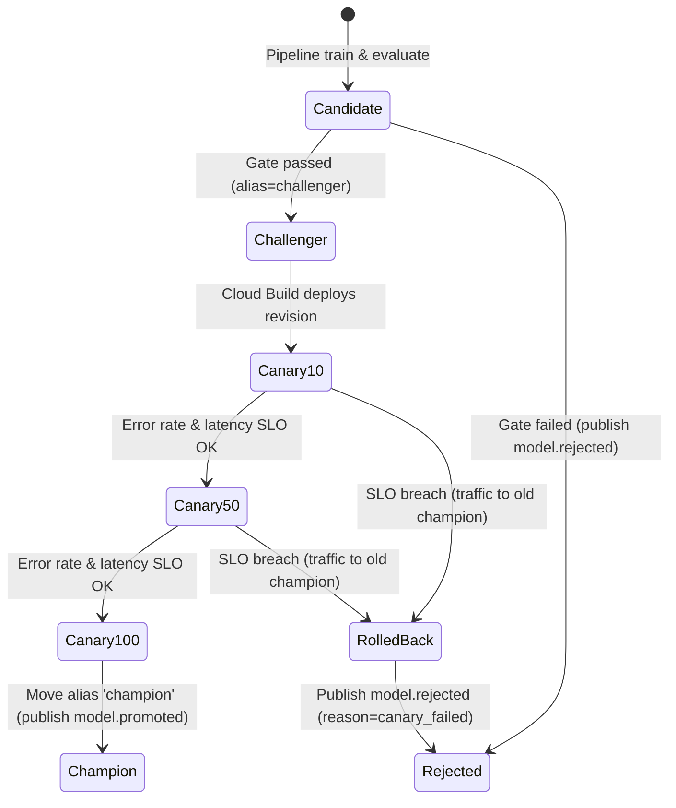

# ChurnOps Model Registry Conventions & Lineage Contract

Vertex AI Model Registry is used as the single source of truth for model artifacts, aliases, and deployment metadata.

## Model Aliases

- `champion`: The model currently handling 100% of production traffic in `ml/serving/`. Only promoted after successfully clearing quality gates and progressive canary delivery.
- `challenger`: The newly trained model candidate produced by the Vertex AI continuous training pipeline, undergoing canary verification (10% -> 50% -> 100%).

## Model Labels & Metadata Lineage

Every registered model artifact in Vertex AI Model Registry MUST include the following immutable labels:

| Label Key | Format | Example | Description |
|---|---|---|---|
| `git_sha` | Short Git SHA (7 chars) | `3d8b2e1` | Git commit of `ml/pipeline/train.py` |
| `data_snapshot` | BigQuery Table Name | `snap_20261002_01` | Exact snapshot table used for training |
| `pipeline_run` | Vertex Pipeline Run ID | `run-ct-20261002-1432` | Vertex AI Pipeline execution ID |
| `drift_trace_id` | Trace ID | `tr-20261002-demo-001` | Original trace ID of the triggering drift event |
| `trained_at` | ISO 8601 Timestamp | `2026-10-02T14:45:00Z` | Registration UTC timestamp |
| `roc_auc` | Float with 4 decimals | `0.8412` | Holdout ROC-AUC score |
| `recall_at_70p` | Float with 4 decimals | `0.7250` | Recall at 70% precision |

## Transition Protocol

