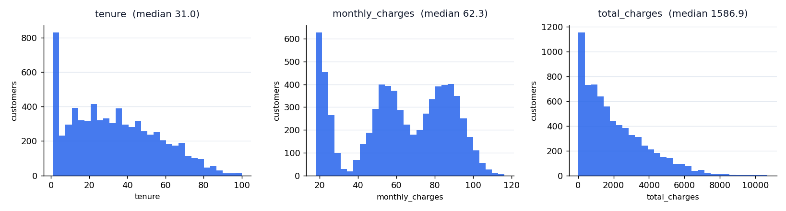
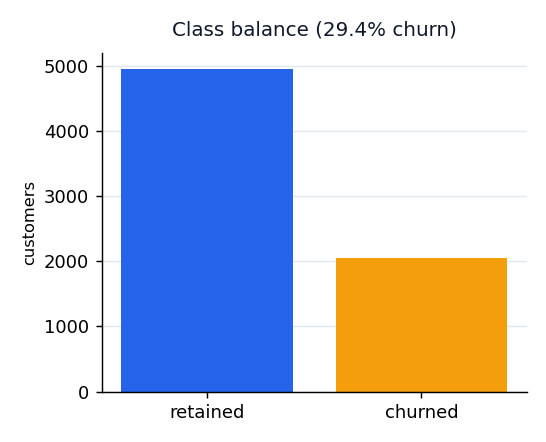
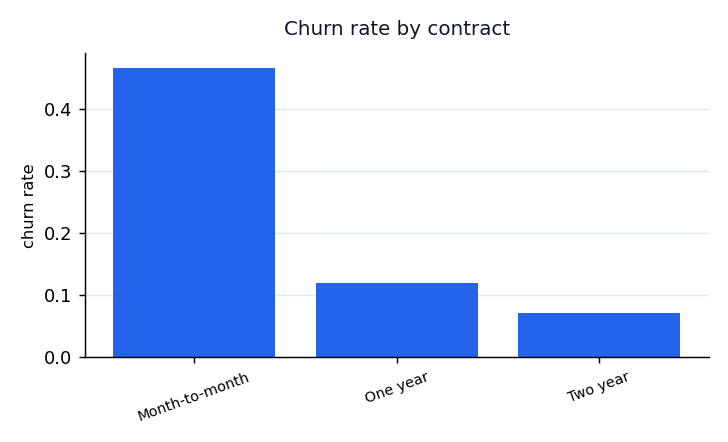
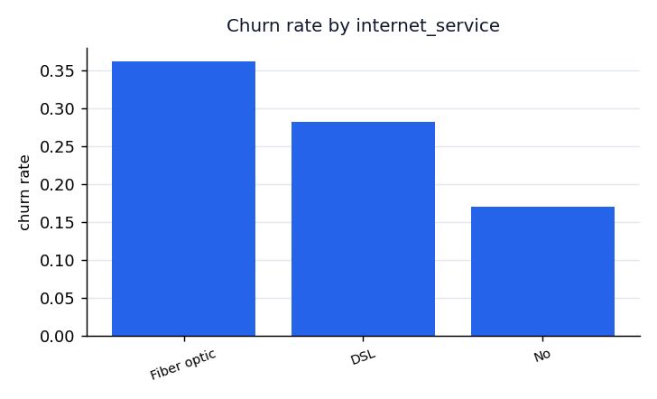
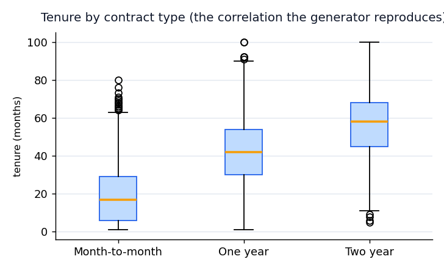
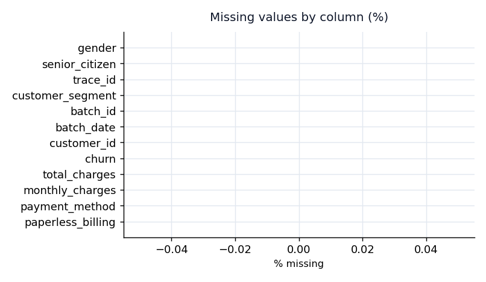

# ChurnOps EDA - seed dataset

_Generated by `scripts/eda.py` on 2026-10-17 from `synthetic:telco-priors` (7,000 rows)._

## What this tells the platform

- **Class balance:** 29.4% of customers churn, so training uses class weights and the business metric is recall at 70% precision, not accuracy.
- **TotalCharges blanks:** brand-new customers have no billed total; the contract imputes the median and the generator reproduces the same pattern.
- **Skew:** `total_charges` is heavily right-skewed, which is why `contracts/features.yaml` applies `log1p` to it and `standard_scale` to `monthly_charges`.
- **Correlation:** tenure rises sharply with contract length; the synthetic generator samples tenure conditioned on contract so drift scenarios stay believable.

## Numeric summary

| statistic | tenure | monthly_charges | total_charges |
| --- | --- | --- | --- |
| count | 7000.0 | 7000.0 | 7000.0 |
| mean | 33.42 | 61.61 | 2060.46 |
| std | 22.92 | 25.56 | 1757.84 |
| min | 1.0 | 18.0 | 17.23 |
| 25% | 15.0 | 45.47 | 667.94 |
| 50% | 31.0 | 62.31 | 1586.94 |
| 75% | 50.0 | 83.7 | 3103.7 |
| max | 100.0 | 116.31 | 10670.95 |

## Missing values

- No missing values in this extract.

## Plots

## Contract implications

| Observation | contracts/features.yaml decision |
| --- | --- |
| `total_charges` right-skewed, blank for new customers | `transform: log1p`, `impute: median` |
| `monthly_charges` roughly tri-modal by internet service | `transform: standard_scale`, drift watched with PSI |
| `tenure` bounded 0-72 in the extract, 0-100 allowed | `min: 0, max: 100`, `min_max_scale` |
| Service columns carry 'No internet service' | kept as categories, not nulls |
| ~26% churn | `recall_at_70_precision` as the business gate |
